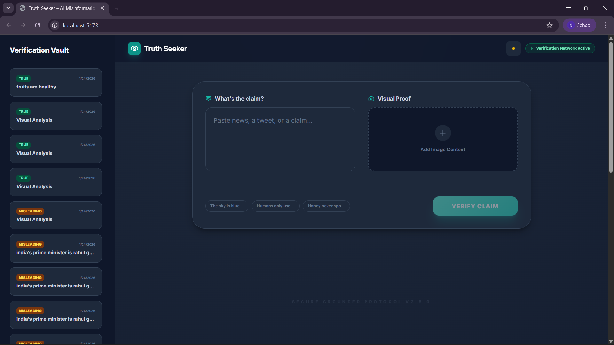

# � TruthSeeker - AI-Powered Misinformation Detector

A modern, locally-runnable fact-checking application powered by **Ollama LLMs** and **OCR technology**. Verify claims, detect misinformation, and analyze images—all running on your machine with **zero cloud dependencies**.


## ✨ Features

- ✅ **Local Processing** - No cloud APIs, your data stays on your machine
- ✅ **Text Analysis** - Fact-check claims and detect misinformation
- ✅ **Image Analysis** - Extract text from images using OCR (Tesseract.js)
- ✅ **Smart Scoring** - Intelligent confidence-based verdict system
  - **≥75% Confidence**: TRUE/FALSE verdict
  - **50-74% Confidence**: MISLEADING
  - **<50% Confidence**: FALSE
- ✅ **Real-time Results** - Instant fact-checking feedback
- ✅ **Analysis History** - Track all previous verifications
- ✅ **Color-Coded Verdicts** - Visual indicators for TRUE (green), FALSE (red), MISLEADING (amber)
- ✅ **Multiple LLM Support** - Works with Ollama models (gemma3, mistral, llama2, etc.)
- ✅ **Fallback to Google GenAI** - Optional cloud API support
- ✅ **Dark Mode & Light Mode** - Beautiful theme toggle for comfortable viewing

## 🎨 Screenshot



*Dark mode interface showing the verification vault with history and main analysis panel*

## 📋 Prerequisites

### Required
- **Node.js** v18+ ([Download](https://nodejs.org))
- **Ollama** ([Download](https://ollama.ai))
- **GPU** (recommended for faster processing)

### Optional
- Git for version control

## 🚀 Quick Start

### 1. Install Ollama
Download and install from [ollama.ai](https://ollama.ai)

### 2. Start Ollama Server
```bash
ollama serve
```
Keep this running in a separate terminal

### 3. Download a Model
```bash
ollama pull gemma3:4b
```

Choose from:
- `gemma3:4b` - Fast, good quality (recommended)
- `mistral` - Balanced performance
- `llama2` - High quality
- `neural-chat` - Optimized for analysis

### 4. Clone & Setup Project
```bash
cd c:\Users\siddh\Desktop\PROJECT\TruthSeeker
npm install
```

### 5. Run the Application
```bash
npm run start
```

Then open **http://localhost:5173** in your browser

## 🎯 Usage

### Text Verification
1. Enter a claim in the text field
2. Click **"VERIFY CLAIM"**
3. View instant analysis with verdict, confidence score, and evidence

### Image Analysis
1. Upload an image containing text
2. Optionally add a claim text
3. Click **"VERIFY CLAIM"**
4. The app will:
   - Extract text from image using OCR
   - Combine with your claim
   - Analyze for misinformation

### Example Claims
- "The sky is blue"
- "Water boils at 100 degrees Celsius"
- "India's prime minister is Rahul Gandhi"

## ⚙️ Configuration

Edit `.env` file to customize:

```env
# Use Ollama (true) or Google GenAI (false)
USE_OLLAMA=true

# Ollama configuration
OLLAMA_URL=http://localhost:11434
OLLAMA_MODEL=gemma3:4b

# Google GenAI API Key (only if USE_OLLAMA=false)
API_KEY=your-api-key-here
```

## 📁 Project Structure

```
TruthSeeker/
├── src/
├── index.tsx              # Frontend UI component
├── server.js              # Express backend with Ollama integration
├── package.json           # Dependencies
├── .env                   # Configuration
├── tsconfig.json          # TypeScript config
├── vite.config.ts         # Vite bundler config
└── README.md              # This file
```

## 🏗️ Architecture

### Frontend Stack
- **React 19** - UI framework
- **TypeScript** - Type safety
- **Vite** - Fast bundler
- **Tailwind CSS** - Styling
- **Tesseract.js** - Client-side OCR

### Backend Stack
- **Node.js + Express** - Server framework
- **Ollama API** - LLM integration
- **Tesseract.js** - Server-side OCR
- **CORS** - Cross-origin support

### Data Flow
```
User Input (Text/Image)
    ↓
Frontend (React)
    ↓
Backend (Express)
    ├─ OCR Processing (if image)
    └─ Ollama API Call
    ↓
LLM Analysis (gemma3:4b)
    ↓
Structured Response Parsing
    ↓
Verdict + Confidence Score
    ↓
Frontend Display & History Save
```

## 🎨 Analysis Verdicts

| Verdict | Color | Meaning | Confidence |
|---------|-------|---------|------------|
| **TRUE** | 🟢 Green | Claim is accurate | ≥75% |
| **FALSE** | 🔴 Red | Claim is inaccurate | <50% |
| **MISLEADING** | 🟡 Amber | Claim has issues | 50-74% |
| **UNCERTAIN** | ⚫ Gray | Unable to verify | Varies |

## 📊 Features Breakdown

### Score Calculation
- Analyzes claim text
- Cross-references with LLM knowledge
- Evaluates evidence quality
- Returns confidence percentage (0-100%)

### Evidence Extraction
The AI automatically identifies:
- Specific claims from input
- Verified reality/facts
- Status (TRUE/FALSE/MISLEADING)

### History Management
- Stores last 20 analyses locally
- Persisted to browser localStorage
- Click to re-view previous verifications

## 🔧 Available Commands

```bash
# Install dependencies
npm install

# Start both backend and frontend
npm run start

# Start only backend (port 3001)
npm run backend

# Start only frontend dev server (port 5173)
npm run dev

# Build for production
npm build

# Preview production build
npm preview
```

## 🌐 Ports

- **Frontend**: http://localhost:5173
- **Backend**: http://localhost:3001
- **Ollama**: http://localhost:11434

## 📝 Supported Image Formats

- JPEG (.jpg, .jpeg)
- PNG (.png)
- WebP (.webp)
- BMP (.bmp)
- TIFF (.tiff)

Max file size: 50MB

## ⚡ Performance Tips

1. **Use GPU** - Ollama automatically uses GPU if available (NVIDIA CUDA/AMD HIP)
2. **Smaller Models** - gemma3:4b is faster than larger models
3. **Batch Processing** - Multiple short claims are faster than one long claim
4. **Pre-warm Model** - First request loads model into memory (slower)

### Typical Performance

| Model | First Request | Subsequent | GPU Memory |
|-------|----------------|-----------|-----------|
| gemma3:4b | 5-15s | 2-5s | ~3GB |
| mistral | 8-20s | 3-8s | ~4GB |
| llama2 | 10-25s | 5-10s | ~5GB |

## 🛠️ Troubleshooting

### "Ollama is not running"
```bash
# Start Ollama in another terminal
ollama serve
```

### "Model not found"
```bash
# Download the model
ollama pull gemma3:4b
```

### "Port 3001/5173 already in use"
```bash
# Kill existing Node processes
Get-Process node | Stop-Process -Force
```

### Slow responses
- Check if GPU is being used: `nvidia-smi`
- Try a smaller model: `ollama pull mistral`
- Increase system RAM

### OCR not working
- Ensure Tesseract.js is installed
- Check image quality (clear text works better)
- Try a simpler image first

## 🔐 Privacy & Security

✅ **100% Local Processing**
- No internet connection required
- Your claims never leave your computer
- No data sent to external services (unless using Google GenAI)
- All analysis happens locally

✅ **No Tracking**
- No analytics
- No user data collection
- Browser-only storage

## 🤝 Contributing

Contributions welcome! Feel free to:
- Report bugs
- Suggest features
- Submit pull requests

## 📄 License

MIT License - See LICENSE file for details

## 🎓 How It Works

1. **User Input** - Accept claim text and/or image
2. **Image Processing** - Extract text using OCR if image provided
3. **Prompt Generation** - Create structured fact-checking prompt
4. **LLM Analysis** - Send to Ollama for analysis
5. **Response Parsing** - Extract verdict and evidence
6. **Verdict Calculation** - Apply confidence-based logic
7. **Display Results** - Show analysis with color-coded verdict
8. **Save History** - Store for future reference

## 🚀 Future Enhancements

- [ ] Multi-language support
- [ ] Advanced fact database integration
- [ ] Real-time news verification
- [ ] Batch analysis mode
- [ ] Export reports (PDF/CSV)
- [ ] Custom LLM fine-tuning
- [ ] Docker containerization
- [ ] Mobile app

## 💡 Use Cases

- ✍️ Verify claims in news articles
- 📱 Check social media posts
- 📸 Analyze screenshots and memes
- 📚 Fact-check academic papers
- 🎥 Verify video transcripts
- 📊 Validate statistics

## 📞 Support

For issues, questions, or suggestions:
1. Check [OLLAMA_SETUP.md](OLLAMA_SETUP.md)
2. Review troubleshooting section above
3. Open a GitHub issue

## 🎉 Acknowledgments

- **Ollama** - Local LLM runtime
- **Tesseract.js** - OCR engine
- **Vite** - Build tool
- **React** - UI framework
- **Tailwind CSS** - Styling

---

**Made with ❤️ for truth-seeking**

Last Updated: January 2026 | v1.0.0
    ```sh
    npm install
    ```

4.  **Start the development server:**
    ```sh
    npm run dev
    ```
    The application will be available at `http://localhost:5173`.

## 🔒 Limitations & Future Work

TruthSeeker now routes analysis through a local backend so the model and API credentials never run in the browser. The Ollama path uses a low-temperature chat request with an 8k context window and JSON-constrained output. The response is normalized before it reaches the UI, and the UI preserves the model's explicit verdict instead of inferring one from confidence alone.

-   **Evidence quality depends on the selected model:** Local Ollama models do not automatically have current web knowledge. Use the Google provider when fresh, search-grounded evidence is required.
-   **No persistent evaluation set yet:** The next quality milestone is a labeled benchmark of claims covering true, false, misleading, and uncertain cases, followed by confidence calibration against that set.

### Future Roadmap

Our goal is to evolve this prototype into a powerful, fully-functional tool. The next steps are:

1.  **Build a labeled evaluation harness:** Measure verdict accuracy, evidence quality, calibration error, and abstention quality across a reproducible dataset.
2.  **Expand multimodal verification:** Add image understanding beyond OCR, including charts, logos, and visual context.
3.  **Add a local evidence index:** Integrate reputable fact-checking datasets for offline retrieval-augmented verification.
4.  **Browser Extension:** Develop a browser extension to allow users to fact-check content directly on social media platforms and news websites.
